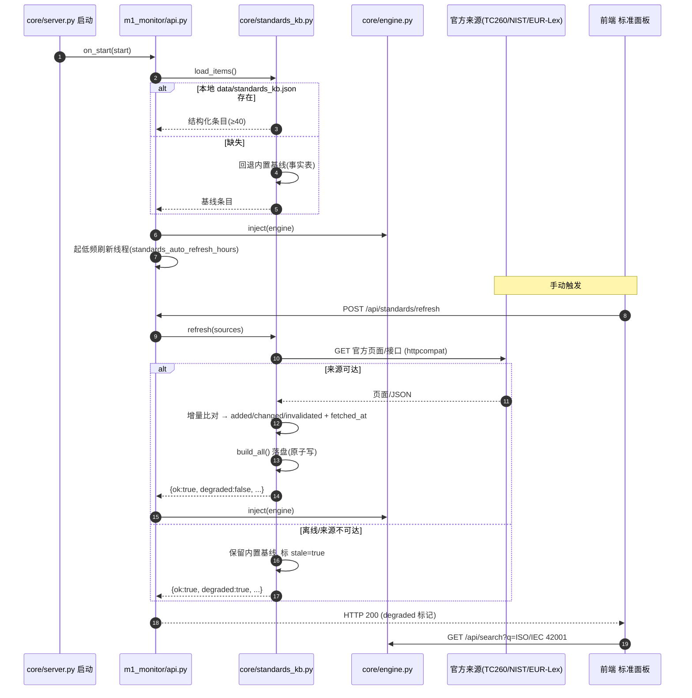
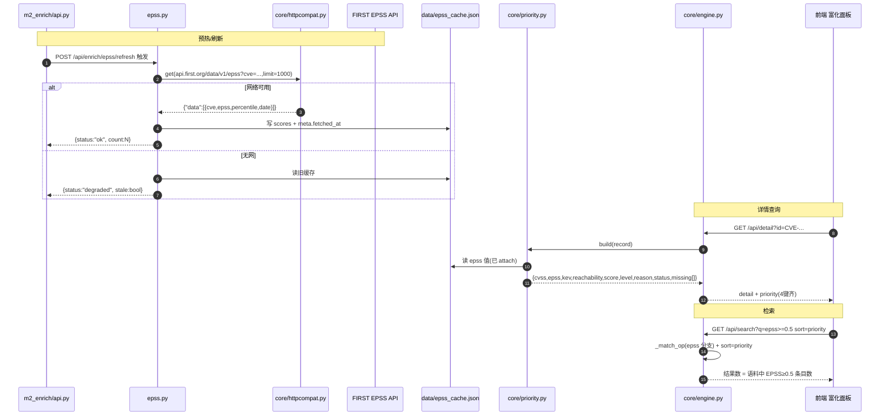
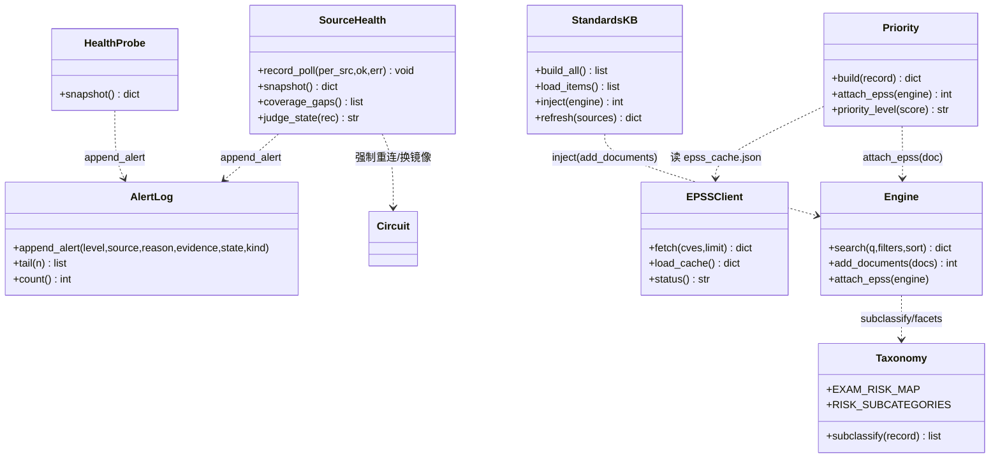

# 增量架构设计 · 赛题九差距补齐

> **文档类型**：增量架构设计 + 任务分解（**只描述本次变更**，不重述系统全貌、不重设计既有架构）
> **作者**：高见远（Gao）· 架构师
> **日期**：2026-10-13
> **项目**：AI-SecIntel 2.2 / 2.3（微内核 `core/` + 四模块 `m0_ops` / `m1_monitor` / `m2_enrich` / `m3_qa`）
> **唯一需求来源**：`交付物/增量PRD_赛题九差距补齐.md`（P0-1 ~ P0-5 / P1-1 / P1-2）
> **事实核对依据**：`_standards_factsheet_20261013.md`（**严禁编造标准编号、生效日期、义务条款**）、`_gap_analysis_20261013.md`
> **写作语言**：简体中文。需求动词口径：**必须**（P0）/ **应该**（P1）。

---

## 0. 前置约束（本设计的一切取舍都基于这些硬约束）

| # | 硬约束 | 对本设计的约束力 |
|---|---|---|
| C1 | **不新增模块、不改微内核 + 四模块拓扑** | 所有新能力落在既有 `core/` 与 `modules/*/` 内；只支持 `ctx.route("GET"/"POST", path, fn)` |
| C2 | **零必装依赖**：新增功能不得引入必装依赖，缺库必须降级 | 网络一律走 `core/httpcompat.py`；不引入 EPSS 客户端库 / 图表库 / 鉴权框架 |
| C3 | **不改写 `data/corpus.json`（291 MB）** | 标准条目采用**运行期合并**注入，不重写大文件（见 §1 P0-1） |
| C4 | **改 `styles.css` / `app.js` 必须递增 `frontend/index.html` 的 `?v=`**（当前 `styles.css?v=38`、`app.js?v=29`、`fx.js?v=6`） | 前端任务 T10 强制项；模块面板改完必须重跑 `tools/组装前端.py` |
| C5 | **语料实时漂移**：服务运行时 `corpus.json` 持续增长（每 15s 一轮） | 一切断言/测试用「≥ 基线」而非等值；对账类断言用「集合/计数一致性」 |
| C6 | **编码风格**：文件头中文 docstring 说明"为什么加"、中文注释、`from __future__ import annotations`、静默异常走 `core/errlog.py:swallow(tag, exc)` 留痕 | 新增文件全部遵守 |
| C7 | 既有 **78 项自测**、检索评测（@1 85.0% / MRR 0.885）、富化五维均值 96.4%、多跳 12/12 为**回归不劣化基线** | T11 必须验证"既有 78 项不因本次改动新增失败"（既有 3 项已知失败保持原状） |

---

## Part A · 系统设计

### 1. 实现方案总览

> 每条需求一句话方案 + 选定理由；末尾列出**被否决的替代方案**（≥2 条，含否决理由）。

#### 1.1 各需求方案

| 需求 | 一句话方案 | 选定理由（结合既有代码） |
|---|---|---|
| **P0-1** 标准/法规知识底座 | 新增 `core/standards_kb.py`，以 **`_kb()` 同款 schema** 落地结构化「标准/法规/义务」条目到独立文件 `data/standards_kb.json`；**运行期合并**注入引擎（复用 `eng.add_documents()`，与快车道注入同机制），并在 `m1_monitor` 挂一个低频刷新线程 + `POST /api/standards/refresh`；离线降级为"内置基线 + `stale` 标记"。 | 复用既有 `data_security_kb.py::_kb()` 构造范式与 `m1_monitor` 注入链路，**零重写 corpus**、**零新依赖**；独立文件使"删除即回滚"成立。条目事实**逐条取自 `_standards_factsheet_20261013.md`**。 |
| **P0-2** EPSS 富化 | 新增 `m2_enrich/backend/epss.py`（走 `core/httpcompat`，单/批量 API + 本地缓存 + 陈旧阈值）；`enrich_dims.py` 增 `key="epss"` 维度（count 读缓存文件真实条数）；新增 `core/priority.py` 计算**优先级四元组**（cvss/epss/kev/reachability），`/api/detail` 挂载；`core/engine.py` 增 `epss` 算子与 `sort=priority`。 | 富化维度体系（`ENRICH_DIMENSIONS` + `_COUNTERS`）已就绪，加一维成本最低；priority 计算放 `core/`（core↔core）避免 core 反向依赖模块，EPSS 抓取留 `m2`，两者以 `data/epss_cache.json` 解耦。 |
| **P0-3** 源健康与缺失告警 | **在既有 per-round 成败统计之上补齐"跨轮"能力**：`live.py` 已有 `src_health()`（第 950 行）返回**本轮** `(ok_list, err_dict)`，本设计**复用它作为"本轮输入"**；新增 `m1_monitor/backend/source_health.py` 做**跨轮持久化**（`last_success_at`/`last_item_at`/`items_24h`/`items_7d_avg` → `ok/degraded/stale/disabled`）与**缺失判定**，告警追加写 `data/alerts.jsonl`；新增 `GET /api/source_health`、`GET /api/coverage_gaps`；`/api/live` 增 `stale_sources[]`。 | **对"缺失数据"而非"异常数据"判定**是本需求核心增量。注意：既有 `_CN_FAIL` 退避（`live.py` 929 行附近）与 `core/circuit.py` 熔断是**既有的"异常数据"响应，保留不动**；本次新增的是"缺失数据"响应（跨轮记账 + 停产/缩水判定），**不重复造轮子**。 |
| **P0-4** MCP/Agentic 独立风险类 | `core/taxonomy.py` 新增 **`RISK_SUBCATEGORIES`**（`MCP Server` / `Agentic AI`，显式登记、父类、颜色），补 `AI_PRODUCTS`/关键词；`subclassify(record)` 运行期派生 `risk_subtags`（引擎加载时挂载，`build_data.assemble()` 落库）。**①~⑪ 编号与 `short` 零变更**。 | 采**子类/标签**挂载而非新增 ⑫，避免打散历史统计与面板口径（Q3 默认处置）；子类在分类 faceting 中作为可点选筛选项露出。 |
| **P0-5** 四类风险显式映射与态势聚合 | `core/taxonomy.py` 增 **`EXAM_RISK_MAP`**（赛题四类 ↔ 本项目分类号 ↔ 判定依据，**多对一/一对多**双向可查）；新增 `GET /api/risk_overview`（计数/占比/严重度分布/Top 组件/POC·KEV 比例 + `mapping[]` + `reconcile{expected,actual,ok}`）。 | 聚合口径直接读引擎，能对账到 `/api/stats`；映射表随接口返回供评审核验（Q4：允许非一一对应）。 |
| **P1-1** 攻击链推理 | `core/atlas.py` 复用既有 `CWE_TO_TECH` + `core/graph_data.py` 的 tactic 节点，新增 `build_attack_chain(record)`；`m3_qa/api.py` 注册 `GET /api/attack_chain?id=` 并接入 `/api/chat`。 | ATLAS 映射与 tactic 节点**已存在**，只缺"有序链路 + 证据 + 可解释"的对外封装，改动面最小。 |
| **P1-2** 存活探活与自愈 | 新增 `core/health_probe.py`（`GET /api/health/live`：`alive/pid/uptime/pidfile/last_poll_age/index_writable`），探活失败/`last_poll_age` 超阈写告警（复用 P0-3 通道），`启动服务_守护.bat` ≤60s 拉起；指标进 `core/metrics.py`。 | 复用既有 `metrics.py`（纯标准库）与看门狗脚本骨架；`/api/health/live` 与 `/api/health` 一样刻意放在 `get_engine()` 之前，避免被冷启动阻塞。 |

#### 1.2 被否决的替代方案（含否决理由）

| # | 替代方案 | 否决理由 |
|---|---|---|
| R1 | **新增独立模块 `m4_standards`** 承载标准/法规 | 违反 C1（不改拓扑）；`registry` 会多出一个模块目录、`module.json`、独立前端面板与生命周期，收益仅"目录整齐"，成本贯穿过大。标准条目本质是"知识条目"，归 `core/standards_kb.py` + `m1_monitor` 采集链路即可。 |
| R2 | **用 `--append` 工具把标准条目并入 `data/corpus.json` 的 `knowledge` 数组**（一次性/定期重写大文件） | 违反 C3（291 MB 大文件不重写）；且运行期每次都要扫/重写巨型 JSON，风险与耗时都不可控。改采**运行期合并**（§1.1 P0-1）。若最终交付需要"预合并语料"，仅作为**离线打包的可选**次级路径（`tools/并入标准库到语料.py`），不作为运行期依赖。 |
| R3 | 为 EPSS 引入第三方客户端库（如 `epss` / `requests` 直连）+ 图表库 | 违反 C2（零必装依赖）。`core/httpcompat.py` 已实现"有 requests 用 requests、无则 urllib 兜底"，直连即可；前端沿用既有内联 SVG 径向渲染，不引图表库。 |
| R4 | 为 MCP/Agentic 新增**独立分类号 ⑫** | 会打散既有 ①~⑪ 编号、历史统计与面板口径（Q3）。改采子类标签挂载。 |
| R5 | 标准/法规**编造额外条目**凑满 ≥40 | 违反 `_standards_factsheet` 使用纪律（"表以外的条目不要写进知识库"）。改采**义务粒度结构化**（见 §1.3），条目内容全部来自事实表已有事实。 |

#### 1.3 关键设计裁决（必须让工程师照做）

**裁决 A：标准条目的"计数粒度"与 ≥40 的口径（对应 AC-1）**
`_standards_factsheet_20261013.md` 中可直接引用、可核验**主体对象**约 25 条（中国国标/部门规章 + 国际框架/标准 + 行业框架）。为在**零编造**前提下达成 AC-1 的"`kind ∈ {技术标准, 政策法规}` 合计 ≥ 40"，采用**两级结构**：
- **标准级条目（standard-level）**：一条标准/法规 = 一条记录，`id` 前缀 `STD:` / `REG:`（`title` 精确含 `ISO/IEC 42001`、`EU AI Act`、`NIST AI RMF`、`TC260`、「生成式人工智能服务管理暂行办法」等，保证 AC-2 精确命中）。
- **义务级子条目（obligation-level）**：对事实表中**已逐条列出义务**的对象（如 EU AI Act 的 Article 12/13/14/15；NIST AI RMF 的 GOVERN/MAP/MEASURE/MANAGE；GB/T 45654 的"训练数据 / 模型 / 安全措施"），按义务拆出子条目，`id` 形如 `REG:EU-AI-ACT-12`，继承父标准字段并带 `parent_id`。

两级合计 ≥ 40 条**全部为事实表已有事实**，不新增任何编号/日期/条款。`GET /api/standards` 与 `/api/stats` 的 `kind_counts` 均按**两级合计**计数。此粒度选择写入 §9 待明确事项（供 PM/评委确认计数口径），但**默认执行**，不阻塞实现。

**裁决 B：标准条目注入路径 = 运行期合并（选定方案）**
- 单一事实源：`data/standards_kb.json`（由 `core/standards_kb.py::build_all()` 生成）。
- 注入：服务启动时 + `POST /api/standards/refresh` 成功后，调用 `core/standards_kb.inject(engine)` → 内部 `engine.add_documents(items)` + `clear_search_cache()`（与快车道 `_live_replay()` 同机制）。
- **回滚方式**：① 删除或重命名 `data/standards_kb.json` → 下次启动不再注入，引擎回到基线语料；② config.json 设 `standards_enabled:false` → 跳过注入与刷新线程。两种方式都**不触碰 `corpus.json`**。

**裁决 C：EPSS 值挂载与算子**
EPSS 不落进 `corpus.json`（C3）。启动时 + EPSS 刷新后，`core/priority.attach_epss(engine)` 从 `data/epss_cache.json` 读值并写入内存文档字段 `doc["epss"]`（与 `ensure_credibility` 挂 `trust_score` 同范式）。`core/engine.py` 据此实现 `epss>=N` 算子与 `sort=priority`。

**裁决 D：告警通道单一化**
P0-3 与 P1-2 共用一条落盘通道：新增 `core/alert_log.py`（追加写 `data/alerts.jsonl` + 原子/轮转），避免 `source_health.py`（m1 backend）被 `core/health_probe.py` 反向依赖（破坏分层）。

---

### 2. 文件清单

> 相对路径以项目根 `E:/aisec-D_3/aisec-D_2.0(1)/aisec-D_2.0` 为基准。

#### 2.1 新增文件

| 类别 | 相对路径 | 职责 | 对应需求 |
|---|---|---|---|
| 后端 | `core/standards_kb.py` | 标准/法规结构化条目模型（两级）、内置基线（事实表）、`build_all()` 落盘、`load_items()`、`inject(engine)`、`refresh()`（增量比对+降级） | P0-1 |
| 后端 | `core/alert_log.py` | 告警 JSONL 追加写 + 轮转（复用 `core/logrotate.py`），`append_alert(level, source, reason, evidence, state, kind)`、`tail(n)`、`count()` | P0-3 / P1-2 |
| 后端 | `core/priority.py` | 优先级四元组计算 `build(record)`、`attach_epss(engine)`（读 `epss_cache.json`）、`priority_level(score)` | P0-2 |
| 后端 | `core/health_probe.py` | 存活探活快照（`pid/uptime/pidfile/last_poll_age/index_writable`），探活失败写告警 + 指标 | P1-2 |
| 后端 | `modules/m2_enrich/backend/epss.py` | FIRST EPSS 单/批量抓取（走 `httpcompat`）、本地缓存 `data/epss_cache.json`、陈旧阈值、降级状态 | P0-2 |
| 后端 | `modules/m1_monitor/backend/source_health.py` | **跨轮持久化层 + 判定层**：以既有 `live.py::src_health()`（本轮 `ok/err`）为输入，维护 `data/source_health.json`，判定 `ok/degraded/stale/disabled`，`snapshot()`/`coverage_gaps()`，stale 告警落盘 | P0-3 |
| 工具（可选） | `tools/并入标准库到语料.py` | **仅离线打包用**：把 `standards_kb.json` 的条目批量并入 `corpus.json#knowledge`（带备份），运行期不用 | P0-1（次级） |
| 产物（运行时生成） | `data/standards_kb.json` | 标准/法规结构化条目（单一事实源） | P0-1 |
| 产物（运行时生成） | `data/source_health.json` | 逐源健康记账（原子写） | P0-3 |
| 产物（运行时生成） | `data/alerts.jsonl` | 告警流水（P0-3+P1-2 共用） | P0-3 / P1-2 |
| 产物（运行时生成） | `data/epss_cache.json` | EPSS 缓存（含 `fetched_at`） | P0-2 |

#### 2.2 修改文件

| 类别 | 相对路径 | 变更点 | 对应需求 |
|---|---|---|---|
| 核心 | `core/taxonomy.py` | 新增 `RISK_SUBCATEGORIES`（MCP Server / Agentic AI，显式登记、父类=①/③、颜色）；补 `AI_PRODUCTS`/`AI_DESC_KEYWORDS`（MCP 生态 + agentic 组件）；新增 `subclassify(record)`；新增 `EXAM_RISK_MAP` + `exam_mapping_list()`。**不动 ①~⑪ 编号与 `short`** | P0-4 / P0-5 |
| 核心 | `core/engine.py` | `OP_KEYS` 增 `epss`；新增 `epss` 比较正则（复刻 `CVSS_CMP_RE` 范式）；`_match_op` 增 `epss` 分支；`search(sort=...)` 增 `priority` 排序；**`search()` 候选与 `facets` 构造增 `kind` 维度并合并 `RISK_SUBCATEGORIES`**；新增 `attach_standards/attach_subtags` 辅助 | P0-2 / P0-4 / P0-1 |
| 核心 | `core/server.py` | `/api/detail` 经 `detail_payload()` 挂 `priority`；`/api/stats` 增 `kind_counts`；新增 `/api/risk_overview`；新增 `/api/health/live`（放在 `get_engine()` 前）；**`/api/search` 的 filters 映射（900~914 行）新增 `kind`（当前为 `severity/category/source/scope/exploited_only/poc_only/has_paper_only/cvss_min/year_from/year_to`，无 `kind`）** | P0-2 / P0-1 / P0-5 / P1-2 |
| 核心 | `core/circuit.py` | **既有熔断（异常数据响应）保留不动**；仅新增"持续 `stale` 达阈值时强制重连/换镜像"入口（供 `source_health` 调用），复用既有 `MIRRORS` 与半开逻辑 | P0-3 |
| 核心 | `core/metrics.py` | 增探活指标（uptime、last_poll_age、index_writable、probe 成功/失败计数） | P1-2 |
| 核心 | `core/atlas.py` | 新增 `build_attack_chain(record)`（复用 `CWE_TO_TECH` + tactic），输出有序链路 + `evidence[]` + `explain` | P1-1 |
| 核心 | `core/self_test.py` | 新增探活/标准/源健康/EPSS/风险态势/攻击链回归项 | 全部 |
| 模块1 | `modules/m1_monitor/backend/live.py` | 每轮轮询后调用 `source_health.record_poll(src_health(), per_source)`；**不改 `src_health()`（950 行）本体**，把它当"本轮输入"；`feed_total` 保持既有语义（**首轮完成前为 0**，不作源清单来源）。既有 `_CN_FAIL` 退避（929 行附近）保留不动 | P0-3 |
| 模块1 | `modules/m1_monitor/api.py` | 新增 `GET /api/source_health`、`GET /api/coverage_gaps`、`GET /api/standards`、`POST /api/standards/refresh`；`live_status()` 增 `stale_sources[]`；`register()` 注册标准刷新后台线程 + 标准注入 | P0-3 / P0-1 |
| 模块1 | `modules/m1_monitor/backend/build_data.py` | `assemble()` 增：① 合并 `standards_kb.json`；② 记录持久化 `risk_subtags` | P0-1 / P0-4 |
| 模块2 | `modules/m2_enrich/backend/enrich_dims.py` | `ENRICH_DIMENSIONS` 增 `{"key":"epss",...}`（`data_file":"epss_cache.json"`, `count_kind":"json_len"`） | P0-2 |
| 模块2 | `modules/m2_enrich/api.py` | 新增 `GET /api/enrich/priority?id=`、`POST /api/enrich/epss/refresh`（批量预热缓存）；`register()` 注册 | P0-2 |
| 模块3 | `modules/m3_qa/api.py` | 新增 `GET /api/attack_chain?id=`；`/api/chat` 答复接入攻击链 | P1-1 |
| 守护 | `启动服务_守护.bat` | 探活目标改为 `/api/health/live`，重启间隔 ≤60s | P1-2 |
| 配置 | `config.json` | 新增 `standards_enabled`、`standards_auto_refresh_hours`、`epss_stale_days`（默认 7）、`source_health_stale_k`（默认 3） | P0-1 / P0-2 / P0-3 |
| 前端 | `frontend/index.html` | 新增「标准/法规」与「赛题四类风险态势」面板容器；**递增 `styles.css?v=39`、`app.js?v=30`**（`fx.js` 若改则递增） | P0-1 / P0-5 |
| 前端 | `frontend/app.js` | `renderStandards()` / `renderRiskOverview()` / `renderSourceHealth()` 挂载点；检索框提示补 `epss>=` / `sort=priority`；分类 faceting 显示 `MCP Server` / `Agentic AI` | P0-1/P0-2/P0-4/P0-5 |
| 前端 | `frontend/styles.css` | 标准条目卡片、四类态势图、`STALE`/`degraded` 徽标（沿用既有色调变量） | P0-1/P0-3/P0-5 |
| 面板 | `modules/m1_monitor/web/panel.js` | 源健康看板（逐源表 + 停产红标 + 缺失清单 + 已停产时长） | P0-3 / P1-2 |
| 面板 | `modules/m2_enrich/web/panel.js` | 富化维度清单增 EPSS 行 + 真实计数；详情页「优先级四元组」小卡 | P0-2 |
| 面板 | `modules/m3_qa/web/panel.js` | 攻击链可视化（复用内联 SVG）+ 合规依据引用段 | P1-1 |
| 面板 | `modules/m0_ops/web/ops.js` | （P2-1，可选）审计留痕 `actor`/`actor_kind` 展示 | P2-1 |
| 文档 | `core/docs/API接口文档.md`、`交付物/AI-SecIntel_2.2_竞赛技术报告_改进版.*`、`交付总览.md`、`演示脚本_5分钟.md` | 新接口补章节、口径表新增行、演示步骤 | P2-3 |

> **前端产物同步铁律**：改 `modules/<id>/web/*` 后**必须**重跑 `tools/组装前端.py` 同步到 `frontend/modules/<id>/`，并递增 `?v=`。

---

### 3. 数据结构与接口

#### 3.1 新增数据结构（JSON schema 风格字段表）

**① 标准/法规条目（`data/standards_kb.json` 的 `items[]`；复用 `_kb()` 字段并扩展）**

| 字段 | 类型 | 说明 |
|---|---|---|
| `id` | str | `STD:*`（技术标准/框架）或 `REG:*`（政策法规）；义务级子条目 `parent_id` 非空 |
| `parent_id` | str\|null | 义务级子条目归属的标准级 `id`；标准级为 `null` |
| `level` | enum | `standard`（标准级）\| `obligation`（义务级） |
| `title` / `title_en` | str | 中文名 / 英文名（`title` 供精确命中，如 `ISO/IEC 42001:2023`） |
| `issuer` | str | 发布机构（非空，AC-3 要求） |
| `region` | enum | `CN` / `EU` / `US` / `INTL` |
| `kind` | enum | `技术标准` / `政策法规` / `行业规范` / `供应链合规`（**AC-1/AC-5 计数键**） |
| `version` | str | 版本（如 `1.0` / `2023`） |
| `effective_date` | str | 生效/施行日期 `YYYY-MM-DD`；**冲突日期并列**（如 EU 高风险义务 `2026-08-02（另有表述：2027-12-02，需人工确认）`） |
| `status` | enum | `现行` / `草案` / `已废止` |
| `applies_to` | str[] | 适用主体 |
| `key_requirements` | str[] | 关键义务要点（逐条可引用） |
| `refs` | str[] | 官方链接（评委核查用，非空时给链接） |
| `tags` | str[] | 检索标签（含 `技术标准`/`政策法规` 等 kind 词，保证 `/api/search` 命中） |
| `review_status` | enum | `auto`（默认）/ `reviewed` |
| `fetched_at` | str | 采集时间 `YYYY-MM-DDTHH:MM:SS` |
| `stale` | bool | 来源不可达/未成功比对时为 `true`（降级标记，条目仍保留） |
| `desc` | str | 与既有 `_kb()` 对齐的描述文本（供 BM25 命中） |

**② EPSS 缓存记录（`data/epss_cache.json`）**

| 字段 | 类型 | 说明 |
|---|---|---|
| `meta.fetched_at` | str | 最近一次成功抓取时间 |
| `meta.source` | str | 固定 `FIRST EPSS` |
| `meta.count` | int | 缓存 CVE 数（= `scores` 键数，供 `enrich_dims` `json_len` 计数） |
| `scores.<CVE>` | obj | `{ "epss": float(0~1), "percentile": float(0~1), "date": "YYYY-MM-DD", "fetched_at": str }` |

> 单位约定：`epss` 与 `percentile` 均为 **0~1 浮点**（EPSS 官方即为 0~1，不乘 100）。

**③ 优先级四元组（`/api/detail` 的 `priority`；`core/priority.build()` 返回）**

| 字段 | 类型 | 说明 |
|---|---|---|
| `cvss` | float\|null | 取自 `record.cvss.score` |
| `epss` | float\|null | 取自 `doc["epss"]`（EPSS 缓存） |
| `kev` | bool | 取自 `bool(record.kev)` |
| `reachability` | enum | `internet-facing` / `internal` / `unknown`（复用 `/api/assets` + 暴露面测绘语义） |
| `score` | int | 0~100 归一化优先级分 |
| `level` | enum | `P0`（立即）/ `P1` / `P2` / `P3` |
| `reason` | str | 可解释理由串，如 `"CVSS 9.8 + EPSS 0.71 + 已入 KEV ⇒ 立即处置"` |
| `status` | enum | `ok` / `degraded`（无网且无缓存时 EPSS 缺失） |
| `missing` | obj[] | 缺失项显式标注 `[{ "field":"epss", "why":"无网且无缓存" }]`（**不得静默省略**，AC-2 要求 4 键齐） |

**④ 源健康记录（`data/source_health.json` + `/api/source_health.sources[]`）**

| 字段 | 类型 | 说明 |
|---|---|---|
| `source` | str | 源名（与 `/api/live` 的 `feed_*` 同口径） |
| `channel` | str | 所属通道（`blogs`/`csdn`/`anquanke`/`xz`/`nvd`/`kev`/`arxiv`） |
| `category` | str | 采集类别（复用 `SOURCE_CATEGORIES` / `BLOG_FEED_CATEGORIES`） |
| `expected_interval` | int | 期望节拍（秒，来自 `SOURCES` 的 gap） |
| `last_success_at` | str\|null | 最近一次抓取成功时间 |
| `last_item_at` | str\|null | 最近一次**有新增条目**时间 |
| `consecutive_failures` | int | 连续失败次数 |
| `items_24h` | int | 近 24h 新增条数 |
| `items_7d_avg` | float | 近 7 日日均条数 |
| `state` | enum | `ok` / `degraded` / `stale` / `disabled` / `unknown`（首轮未完成） |
| `stale_for_sec` | int | 已停产时长（`state==stale` 时 >0） |
| `alerts_total` | int | 该源累计告警数 |

> 判定规则（默认 `k=3`，可配）：`now - last_item_at > k × expected_interval` **或** `items_24h==0 且 items_7d_avg>0` ⇒ `stale`；`items_24h < 0.3 × items_7d_avg` ⇒ `degraded`。

**⑤ 告警记录（`data/alerts.jsonl` 每行）**

| 字段 | 类型 | 说明 |
|---|---|---|
| `ts` | str | `YYYY-MM-DDTHH:MM:SS` |
| `level` | enum | `warn` / `critical` |
| `kind` | enum | `source_missing`（P0-3）/ `health_probe`（P1-2） |
| `source` | str | 源名（探活类为 `core` / 进程名） |
| `reason` | str | 人类可读原因 |
| `evidence` | obj | 结构化证据，如 `{"state":"stale","items_24h":0,"last_item_at":"2026-10-07T08:00:00"}` |
| `state` | str | 触发时状态（`stale`/`degraded`/`down`） |

**⑥ 风险态势聚合（`GET /api/risk_overview` 返回体）**

| 字段 | 类型 | 说明 |
|---|---|---|
| `categories[]` | obj[] | 每项：`exam_id`（E1~E4）、`exam_name`、`project_categories[]`、`count`、`pct`、`severity_dist{critical,high,medium,low,unknown}`、`top_products[]`、`poc_ratio`、`kev_ratio` |
| `mapping[]` | obj[] | 映射表：`exam_id`、`exam_name`、`project_categories[]`、`basis`（判定依据，供逐条核验） |
| `reconcile` | obj | `{ "expected": int, "actual": int, "ok": bool }`（四类计数之和 vs `/api/stats` 对应分类号合计，误差 0） |
| `generated_at` | str | 生成时间 |

**⑦ 攻击链（`GET /api/attack_chain` 返回体）**

| 字段 | 类型 | 说明 |
|---|---|---|
| `id` | str | 情报编号 |
| `chain[]` | obj[] | 有序跳：`{ "step": int, "stage": str(战术阶段), "technique": {"id":"AML.T0051","name":str}, "evidence[]": str(可 `/api/detail` 打开的引用 id), "why": str }` |
| `explain` | str | 链路级可解释说明（非空） |
| `reason` | str | 无 ATLAS 映射时返回 `chain:[] ` + 非空原因（HTTP 200，不报错） |

#### 3.2 新增 / 变更的 HTTP 接口

| 方法 | 路径 | 关键参数 | 返回体关键字段 | 需求 |
|---|---|---|---|---|
| GET | `/api/standards` | `q`、`kind`、`region`、`status`、`size` | `{ ok, total, counts:{kind→n}, items[] }` | P0-1 |
| POST | `/api/standards/refresh` | — | `{ ok, degraded:bool, added, changed, invalidated, stale, total }`（**HTTP 200，降级不崩、条目不减少**） | P0-1 |
| GET | `/api/source_health` | — | `{ ok, total, summary:{ok,degraded,stale,disabled,unknown,alerts_total}, sources[] }`。**源清单来自静态源定义表**（`live.py` 92~156 行 RSS 列表 + 1761~1771 行调度表），`total` = 定义表条目数；**首轮轮询完成前**返回全部源且 `state="unknown"`（**不返回空数组**） | P0-3 |
| GET | `/api/coverage_gaps` | — | `{ ok, count, gaps[]:{source, reason, stale_for_sec, evidence} }` | P0-3 |
| GET | `/api/live`（变更） | — | 新增 `stale_sources[]`（键必须存在，停产时非空）；`feed_total` **保持既有语义不变**（首轮前为 0），**不作为源清单来源** | P0-3 |
| GET | `/api/enrich/dimensions`（变更） | — | 维度列表含 `{"key":"epss","count":N}`（N≥200，读缓存真实条数） | P0-2 |
| GET | `/api/enrich/priority` | `id` | `{ ok, id, priority{四元组} }` | P0-2 |
| POST | `/api/enrich/epss/refresh` | `cves`(可选)、`limit`(默认 1000) | `{ ok, status:ok\|degraded, fetched, cached, count }` | P0-2 |
| GET | `/api/detail`（变更） | `id` | 新增 `priority` 四元组（4 键齐全，缺失项 `null`+`missing`） | P0-2 |
| GET | `/api/search`（变更） | `q` 支持 `epss>=N`；`sort=priority`；facets 增 `kind` | `facets.kind`、`facets.category` 含 `MCP Server`/`Agentic AI` | P0-2/P0-4/P0-1 |
| GET | `/api/stats`（变更） | — | 新增 `kind_counts:{技术标准,政策法规,行业规范,供应链合规}` | P0-1 |
| GET | `/api/risk_overview` | — | 见 §3.1⑥ | P0-5 |
| GET | `/api/attack_chain` | `id` | 见 §3.1⑦ | P1-1 |
| GET | `/api/health/live` | — | `{ alive, pid, uptime_sec, pidfile, last_poll_age, index_writable }`（索引不可写时 `alive:true, index_writable:false`） | P1-2 |

**接口签名示例（关键处，仅签名与结构，非完整实现）**

```python
# core/standards_kb.py
def build_all() -> list[dict]: ...            # 依据事实表生成 items → data/standards_kb.json
def load_items() -> list[dict]: ...           # 读盘；缺失时返回内置基线（不抛）
def inject(engine) -> int: ...                # engine.add_documents(items) + clear_search_cache()
def refresh(sources=None) -> dict: ...        # 增量比对；离线返回 {"degraded": True, ...}，条目不减

# core/priority.py
def build(record: dict) -> dict: ...          # 返回四元组 + score/level/reason/status/missing
def attach_epss(engine) -> int: ...           # 从 data/epss_cache.json 写入 doc["epss"]

# core/alert_log.py
def append_alert(level: str, source: str, reason: str,
                 evidence: dict | None = None, state: str = "", kind: str = "") -> None: ...
```

#### 3.3 验收口径（实测校准 · **T11 以此判定**）

> 以下口径由 team-lead 在 8848 实测基线校准得出，**覆盖并修正 PRD 中过宽的判据**。工程师实现与自测断言一律以本节为准。

**① `/api/search` 的 `total` 是 OR 语义，AC-2 禁用 `total ≥ 1`**
实测基线（改进前）：

| 查询 | total（OR 命中） |
|---|---|
| `ISO/IEC 42001` | 47 |
| `EU AI Act` | 26505 |
| `NIST AI RMF` | 26456 |
| `TC260` | 3 |
| `生成式人工智能服务管理暂行办法` | 110330 |
| `OWASP LLM` | 20218 |

多词是 OR，命中几乎所有文档。**因此 P0-1 的 AC-2 必须改用"首条命中谓词判定"**：`results[0].kind ∈ {技术标准, 政策法规}` **或** `results[0].id` 以 `STD:`/`REG:` 开头（二者取或），**不得用 `total ≥ 1`**——否则一篇"碰巧提到"的博客就能让 AC 假通过。逐词（`ISO/IEC 42001`、`EU AI Act`、`NIST AI RMF`、`TC260`、`生成式人工智能服务管理暂行办法`）各跑一次，全部满足首条谓词才算通过。

**② P0-3 AC-1 不使用瞬时 `feed_total`**
实测：服务刚起 60s 时 `/api/live` 返回 `{"feed_ok":0,"feed_fail":{},"feed_total":0,"last_poll":null,"live_docs":1286}`。**`feed_total` 在首轮探测完成前必然是 0**，若以它做源数判据会误判失败。故：
- **源清单来源 = 静态源定义表**（`live.py` 92~156 行 RSS 列表 + 1761~1771 行调度表），`/api/source_health.total` = 定义表条目数；
- **首轮未完成时**返回全部源、`state="unknown"`（不是空数组）；首轮完成后逐源转为 `ok/degraded/stale`；
- 对账判据改为 `source_health.total == 静态源定义表条目数`，`feed_total` 仅作**首轮完成后**的参考性交叉核对。

**③ 实测基线快照（供"改进前后"核对）**
- `/api/health`：`version 2.3` / `engine_loaded true` / **`docs 109570`**（语料实时漂移，60s 内 108341→109570，**任何断言用 ≥ 基线**）。
- `/api/enrich/dimensions`：`dimension_count = 16`，key 依次为 `papers, affected_assets, poc, metasploit, cvss, kev, remediation, credibility, stix_taxii, vuln_env, asset_scan, asset_search, subscribe, graph, cmdb, disposition` —— **无 `epss`**。改进后 `dimension_count = 17` 且含 `epss`。
- `/api/live`：`interval 15`、`live_docs 1286`。

**④ 运行环境事实（设计/验收不得依赖语义向量）**
项目自带 `.venv`（Python 3.13.14），已装 `requests / numpy / bs4 / openai / openpyxl / markdown`；**未装 `transformers` / `torch`** → 语义索引处于降级态、走**纯关键词**。因此 **P0-1 / P0-2 的验收必须走"关键词 + 结构化条目 + 结构化算子"路径**（`epss>=` 走 `_match_op` 属关键词/结构化路径，不依赖向量），**不得**依赖 `POST /api/qa/build_vector` 的语义召回达标。

**⑤ 逐条 AC 的校准后判据（P0/P1）**

| AC | 校准后判据（替代 PRD 原文） |
|---|---|
| P0-1 AC-2 | 5 个点名词各跑 `/api/search`，**首条** `results[0].kind∈{技术标准,政策法规}` 或 `id` 前缀 `STD:`/`REG:`（**非** `total≥1`） |
| P0-1 AC-1 | `/api/stats.kind_counts` 中 `技术标准 + 政策法规 ≥ 40`（两级粒度见 §1.3 裁决 A） |
| P0-1 AC-4 | 断网/屏蔽来源后 `POST /api/standards/refresh` → HTTP 200 且 `degraded:true`，`total` **不减少** |
| P0-3 AC-1 | `/api/source_health.total` = 静态源定义表条目数；首轮未完成时全部 `state="unknown"`；首轮完成后逐源有 `state` |
| P0-3 AC-2 | 以既有停产台账复现，`/api/source_health` **≥1 个 `state="stale"`** 且其在 `/api/coverage_gaps` 在列 |
| P0-2 AC-1 | `/api/enrich/dimensions` 含 `key="epss"` 且 `count ≥ 200`（读 `epss_cache.json` 真实键数） |
| P0-2 AC-5 | `q=epss>=0.5` 的 **结果数** = 语料中 EPSS ≥ 0.5 条目数（结构化算子，误差 0） |
| P0-4 AC-2/3 | `/api/search?q=mcp server` 的 `facets.category` 出现 `MCP Server`，计数 = 归类条目数 |
| P0-5 AC-2 | `/api/risk_overview.reconcile.ok == true` 且 `expected == actual`（误差 0） |
| 回归 | `NO_PROXY=127.0.0.1,localhost python core/self_test.py 8848`：**既有 78 项不因本次新增失败**（既有 3 项已知失败保持原状） |

---

### 4. 程序调用流程

> 见 §4.1 ~ §4.3 的 Mermaid 图（内联，可直接渲染）。

#### 4.1 标准/法规增量采集与降级



#### 4.2 EPSS 富化与优先级四元组计算



#### 4.3 源健康度判定与告警闭环

```mermaid
flowchart TD
    A[live.py poll_once 一轮] --> B{逐源抓取}
    B -->|成功/空| C[per_source 计数 + src_health ok/err]
    B -->|异常| D[circuit.record(False)]
    C --> E[source_health.record_poll(per_src, ok, err)]
    D --> E
    E --> F[更新 last_item_at/items_24h/items_7d_avg]
    F --> G{判定 state}
    G -->|items_24h==0 且 7d_avg>0<br/>或 now-last_item>k*interval| H[state=stale 计算 stale_for_sec]
    G -->|items_24h < 0.3*7d_avg| I[state=degraded]
    G -->|正常| J[state=ok]
    H --> K[alert_log.append_alert(warn/critical)]
    K --> L{stale 达阈值?}
    L -->|是| M[circuit.breaker 强制半开/换镜像]
    M --> N{重连成功?}
    N -->|否| O[升级 critical 告警, 记 alerts.jsonl]
    N -->|是| P[state 回落 ok, 记恢复]
    L -->|否| Q[继续观察]
    H --> R[GET /api/source_health + /api/coverage_gaps]
    J --> R
    I --> R
    R --> S[GET /api/live.stale_sources 前端红标 STALE]
    O --> T[core/health_probe 存活探活]
    T --> U[启动服务_守护.bat ≤60s 拉起]
```

---

## Part B · 任务分解

### 5. 依赖包变化

**结论：新增必装依赖数 = 0。**

| 能力 | 依赖 | 降级策略 |
|---|---|---|
| EPSS 抓取 | 无（走 `core/httpcompat`） | 无 `requests` 时 httpcompat 用 `urllib` 兜底；无网用缓存 + `status=degraded` |
| 标准/法规采集 | 无（同上） | 无网用内置基线 + `stale` 标记，条目不减少 |
| 前端图表 | 无（内联 SVG，复用既有径向渲染） | 不引图表库 |
| 鉴权 | 无（P2-1 仅 `X-Actor` 头轻量标识） | 缺省记为 `anonymous/auto` |
| YAML（ATLAS，既有） | **既有** PyYAML 仅在联网解析 `ATLAS.yaml` 时需要 | 已有 `data/atlas.json` 缓存则零依赖（沿用既有行为，不改） |

> 回归口径：`tools/检查依赖.py` + 断网复跑，确认缺库路径全部降级。

### 6. 任务列表（有序 · 带依赖 · 按实现顺序）

> 顺序即执行顺序；每个任务标「涉及文件 / 依赖 / 完成判据 / 预估规模」。粒度保证"一个模块相关文件一起写"。
> **注意**：`core/server.py`（T04）与 `modules/m1_monitor/api.py`（T06→T07）会被多个任务先后修改，**必须按编号顺序串行**，不得并行编辑同一文件。

| 编号 | 标题 | 涉及文件 | 依赖前置 | 完成判据 | 预估规模 |
|---|---|---|---|---|---|
| **T01** | 基座：共享数据层与告警通道 | `core/alert_log.py`（新）、`core/priority.py`（新）、`core/standards_kb.py`（新）、`config.json` | 无 | 三模块可独立跑通：`standards_kb.build_all()` 产出 ≥40 条（含 AC-2 点名对象）；`priority.build()` 对样例 CVE 返回 4 键齐；`alert_log.append_alert/tail` 可写读 `data/alerts.jsonl`；新增 config 字段有默认值 | ~600 行 |
| **T02** | 分类学与四类风险映射 | `core/taxonomy.py` | T01 | `RISK_SUBCATEGORIES` 含 `MCP Server`/`Agentic AI` 且 **①~⑪ 编号与 `short` 零变更**；`subclassify()` 能把含 `mcp server` 的样例归入子类；`EXAM_RISK_MAP` 双向可查、`exam_mapping_list()` 可返回 | ~250 行 |
| **T03** | 检索引擎扩展 | `core/engine.py` | T01,T02 | `OP_KEYS` 含 `epss`；`q=epss>=0.5` 走 `_match_op` 分支；`sort=priority` 生效；facets 含 `kind` 且合并子类；`attach_subtags/attach_epss` 可对 `engine.docs` 挂载 | ~300 行 |
| **T04** | 服务端路由与聚合 | `core/server.py` | T01,T02,T03 | `/api/detail` 返回 `priority`（4 键齐）；`/api/stats` 含 `kind_counts`；`/api/risk_overview` 返回 4 类 + `mapping[]` + `reconcile.ok`；`/api/health/live` 在 `get_engine()` 前可用；`/api/search` facets 含 `kind` | ~400 行 |
| **T05** | P0-2 EPSS 富化（模块2） | `modules/m2_enrich/backend/epss.py`（新）、`modules/m2_enrich/backend/enrich_dims.py`、`modules/m2_enrich/api.py` | T01,T03,T04 | `/api/enrich/dimensions` 含 `key="epss"` 且 `count≥200`；`/api/enrich/priority?id=` 可用；无网时 `status="degraded"` 且维度不消失 | ~350 行 |
| **T06** | P0-3 源健康与缺失告警（模块1） | `modules/m1_monitor/backend/source_health.py`（新）、`modules/m1_monitor/backend/live.py`、`core/circuit.py`、`modules/m1_monitor/api.py` | T01,T04 | 以 `src_health()`（950 行）为本轮输入回填跨轮记账；`/api/source_health.total == 静态源定义表条目数`（**不依赖瞬时 `feed_total`**，首轮未完成全部 `state="unknown"`，不返回空数组）；以停产台账复现 `state="stale" ≥ 1` 且进 `/api/coverage_gaps`；`data/alerts.jsonl` 追加 ≥1 条含 `ts/source/reason`；`/api/live.stale_sources` 键存在；无网 HTTP 200；既有 ①~⑪ 与 `feed_total` 语义零变更 | ~450 行 |
| **T07** | P0-1 标准/法规采集与注入接入（模块1） | `modules/m1_monitor/api.py`（增补）、`modules/m1_monitor/backend/build_data.py`、`tools/并入标准库到语料.py`（可选） | T01,T04,T06 | `/api/standards`（含筛选）与 `POST /api/standards/refresh` 可用；**AC-2 用"首条命中谓词"判定**（`results[0].kind∈{技术标准,政策法规}` 或 `id` 前缀 `STD:`/`REG:`，**非 `total≥1`**）5 词全过；断网 refresh 返回 `degraded:true` 且 HTTP 200、条目不减；`/api/stats.kind_counts` 合计 ≥40；`/api/search` 的 `kind` facet（联动 `server.py` filters 映射 + `engine.py` facets 构造）可用 | ~300 行 |
| **T08** | P1-1 攻击链推理 | `core/atlas.py`、`modules/m3_qa/api.py` | T02,T03,T04 | 对 10 个已知 AI 组件 CVE 中 ≥8 个返回 ≥3 跳；每跳含 `stage/technique/evidence[]/why`；`explain` 非空；无映射条目返回 `chain:[]`+`reason`（HTTP 200）；**不依赖语义向量** | ~300 行 |
| **T09** | P1-2 存活探活与自愈 | `core/health_probe.py`（新）、`core/metrics.py`、`启动服务_守护.bat` | T04 | `/api/health/live` 返回 `alive:true` + `pid/uptime_sec/pidfile`；索引不可写时 `alive:true,index_writable:false`；杀进程后守护 ≤60s 恢复可达且 `alerts.jsonl` 留记录；探活进 `metrics` | ~250 行 |
| **T10** | 前端面板与样式 | `frontend/index.html`（+`?v=`递增）、`frontend/app.js`、`frontend/styles.css`、`modules/m1_monitor/web/panel.js`、`modules/m2_enrich/web/panel.js`、`modules/m3_qa/web/panel.js`、`modules/m0_ops/web/ops.js`、重跑 `tools/组装前端.py` | T05,T06,T07,T08 | 标准面板/四类态势/源健康看板/EPSS 卡/攻击链可视化可见；`styles.css?v=39`、`app.js?v=30` 已递增；所有外部数据经 `esc()` 白名单转义；下钻结果数 = 面板计数 | ~500 行 |
| **T11** | 自测回归与交付文档 | `core/self_test.py`、`core/docs/API接口文档.md`、`交付物/AI-SecIntel_2.2_竞赛技术报告_改进版.*`、`交付总览.md`、`演示脚本_5分钟.md` | T01~T10 | `NO_PROXY=127.0.0.1,localhost python core/self_test.py 8848` **既有 78 项不因本次新增失败**（既有 3 项已知失败保持原状）；新增探活/标准/源健康/EPSS/态势/攻击链项全绿；新接口在 API 文档 100% 有章节 | ~350 行 |

**总任务数：11（落在 8~12 区间）。**

---

### 7. 共享知识（跨文件约定）

> 工程师在多个任务中都会用到，务必统一。

**7.1 ID 前缀与命名**

- 标准级：`STD:<slug>`（技术标准/框架）；`REG:<slug>`（政策法规）。示例：`STD:ISO-42001`、`STD:NIST-AI-RMF`、`REG:EU-AI-ACT`、`REG:TC260-AI-GOV-FRAME`。
- 义务级：`<父id>-R<n>` 或 `<父id>-<article>`，示例：`REG:EU-AI-ACT-12`、`STD:NIST-AI-RMF-GOVERN`。子条目必带 `parent_id`、`level="obligation"`。
- 告警：`kind ∈ {source_missing, health_probe}`。
- 风险子类标签值（用于 `doc["risk_subtags"]` 与 facets）：**`MCP Server`**、**`Agentic AI`**（与 `RISK_SUBCATEGORIES` 键严格一致）。
- 赛题类别 id：`E1`=AI 基础设施/推理框架、`E2`=模型与数据层、`E3`=AI 应用与智能体、`E4`=供应链。

**7.2 字段命名 / 单位 / 枚举**

- EPSS：`epss` **0~1 浮点**，`percentile` **0~1 浮点**（不乘 100）；缓存条目字段名固定 `epss/percentile/date/fetched_at`。
- 优先级：`score` 为 **0~100 整数**；`level ∈ {P0,P1,P2,P3}`；四元组键固定 `cvss/epss/kev/reachability`（**键必须齐全**，缺失用 `null` + `missing[]`）。
- `reachability ∈ {internet-facing, internal, unknown}`。
- 源健康：`state ∈ {ok, degraded, stale, disabled, unknown}`（`unknown` = 首轮轮询未完成，源清单来自静态定义表）；时间字段统一 `YYYY-MM-DDTHH:MM:SS`。
- 分类：`category` 值保持既有 ①~⑪ 全称字符串**原样**；子类只出现在 `risk_subtags` 与 facets，**不改 `category`**，保证 P0-5 AC-5 回归对照 414/741/1139/538 不减少。
- `kind ∈ {技术标准, 政策法规, 行业规范, 供应链合规}`（用于 `kind_counts` 与 facets）。
- `region ∈ {CN, EU, US, INTL}`；`status ∈ {现行, 草案, 已废止}`；`review_status ∈ {auto, reviewed}`。

**7.3 数据文件路径（一律走 `core/paths.py`）**

| 用途 | 路径 | 写方 | 读方 |
|---|---|---|---|
| 标准/法规条目 | `data/standards_kb.json` | `core/standards_kb.py` | 同上 / `build_data.py` |
| EPSS 缓存 | `data/epss_cache.json` | `m2_enrich/backend/epss.py` | `core/priority.py`、`enrich_dims.py` |
| 源健康记账 | `data/source_health.json` | `source_health.py` | `m1_monitor/api.py` |
| 告警流水 | `data/alerts.jsonl` | `core/alert_log.py` | `source_health.py`、`health_probe.py`、前端 |

> **禁止**再写 `os.path.join(HERE, "data")`；一律 `paths.data_path(...)`。

**7.4 版本号递增点（硬约束）**

- `frontend/index.html`：改 `styles.css` → `?v=38 → 39`；改 `app.js` → `?v=29 → 30`；`fx.js` 若改则 `?v=6 → 7`。
- `module.json` 的 `routes` 数组：T05/T06/T07/T08 新增路由后**同步补登**（声明式清单，供核查脚本）。
- `config.json` 的 `_说明`：新增开关时同步补一行说明（既有约定）。

**7.5 编码约定**

- 文件头中文 docstring 写"为什么加这个"（讲清动机，不只讲功能）。
- `from __future__ import annotations` + 中文注释；静默异常 `from errlog import swallow as _swallow`，`_swallow("<文件>:<行>", e)`。
- 网络一律 `import httpcompat as requests` 式兜底（见 `httpcompat.py` docstring），**不直接 `import requests`**。
- 大文件/共享文件写入用"先写 `.tmp` 再 `os.replace`"原子写（对齐 `circuit.py::_save_state`）。
- 告警 JSONL 追加写、禁止整读整写。

---

### 8. 风险与回滚

| 需求 | 风险点 | 缓解 | 回滚方式（备份/开关） |
|---|---|---|---|
| **P0-1** | ①注入的条目污染检索排序；②刷新线程联网失败拖慢启动；③事实日期冲突被"四舍五入" | 注入用 `add_documents` 且条目 `category` 归入 knowledge 集合，不打乱 CVE 排序；刷新在**后台线程 + 低频**；EU 高风险义务日期**并列写出**（`2026-08-02（另有表述：2027-12-02，需人工确认）`） | 删除/重命名 `data/standards_kb.json`；或 `config.standards_enabled=false`。**不触碰 `corpus.json`**（无需备份大文件） |
| **P0-2** | ①EPSS 缓存陈旧导致失真；②无网整维消失；③priority 与 KEV 判据矛盾 | 陈旧阈值默认 **7 天**，超期 UI 标黄 + `status=degraded`；维度定义常驻 `ENRICH_DIMENSIONS`（不因无网消失）；`priority_level` 强制"KEV=yes ⇒ 不低于最高档" | 缓存备份 `data/epss_cache.json.bak`；删除缓存文件即回到"无 EPSS 值但有维度"降级态 |
| **P0-3** | ①误判停产（快源本就常空）；②`feed_total` 口径漂移导致 AC-1 对不上；③告警刷屏 | 判定复用 `circuit.py` 的"持续空"时间语义 + `k=3×interval`；`feed_total` 单一来源（`/api/live` 改读 `source_health`）；同一源同状态**去重**（状态变化才写告警） | 备份 `data/source_health.json`、`data/alerts.jsonl`；删除即重置记账 |
| **P0-4/P0-5** | ①子类打散 ①~⑪ 统计；②映射被质疑"硬凑" | 子类只挂 `risk_subtags`，**不改 `category`**；`EXAM_RISK_MAP` 随 `/api/risk_overview` 返回 `mapping[]` 供逐条核验 | `taxonomy.py` 用 `git` 备份（改动集中在单文件）；回滚 = 还原 taxonomy.py |
| **P1-1** | 无 ATLAS 映射条目报错 | 返回 `chain:[]` + `reason`（HTTP 200） | `atlas.py` 单文件回滚 |
| **P1-2** | ①守护误杀健康实例；②探活被冷启动阻塞 | `/api/health/live` 放在 `get_engine()` 前；`index_writable=false` 不判死；探活连续失败才拉起 | 还原 `启动服务_守护.bat`；`health_probe.py` 单文件删除即回退 |

**统一备份清单（改动前 `cp` 一份到 `data/_backup_20261013/`）**：`core/taxonomy.py`、`core/engine.py`、`core/server.py`、`core/circuit.py`、`core/metrics.py`、`core/atlas.py`、`modules/m1_monitor/api.py`、`modules/m1_monitor/backend/live.py`、`modules/m2_enrich/api.py`、`modules/m2_enrich/backend/enrich_dims.py`、`modules/m3_qa/api.py`、`frontend/index.html`、`frontend/app.js`、`frontend/styles.css`。

**总回滚权限**：以上全部改动**不涉及** `data/corpus.json`、`data/*.idxcache`、`data/vector_store/` 等大/共享产物；回滚 = 还原源码 + 删除 4 个新增 `data/*.json(l)` 产物即可，语料与索引不受影响。

---

### 9. 待明确事项

| # | 待确认点 | 影响 | 默认处置（无人工指示则按此执行） |
|---|---|---|---|
| Q1 | **AC-1「≥40 条」的计数粒度**：事实表可直接核验的主体对象约 25 条；本设计用"标准级 + 义务级"两级合计达成 ≥40。是否接受该粒度？ | P0-1 AC-1 | **接受两级计数**（义务内容逐条取自事实表，不编造）；若评委要求"仅标准级 ≥40"，需授权从官方来源枚举更多真实标准（走刷新通道），届时再补 |
| Q2 | **EU AI Act 高风险义务生效日冲突**（`2026-08-02` vs `2027-12-02`） | P0-1 条目可信度 | 条目 `effective_date` **并列写出两表述并标"需人工确认"**（遵守事实表纪律，不四舍五入） |
| Q3 | **EPSS 陈旧阈值**与更新频率 | P0-2 AC-4 | 采用**缓存 + degraded 标记**；陈旧阈值 **7 天**（`config.epss_stale_days=7`），超期 UI 标黄 |
| Q4 | **MCP/Agentic 是否新增独立分类号 ⑫** | P0-4 AC-1、P0-5 AC-5 | 采**子类标签**挂载，不动 ①~⑪（若坚持独立编号，需接受历史统计口径变更） |
| Q5 | **赛题四类与 ①~④ 是否必须一一对应** | P0-5 AC-3 | 允许**多对一/一对多**；接口返回 `mapping[]` 供核验，不追求表面整齐 |
| Q6 | **`data/alerts.jsonl` 是否纳入 `core/logrotate.py` 轮转** | P0-3 工程合规 | 纳入轮转（按大小切分 + 保留 N 份），不改动任何既有大文件 |
| Q7 | **源健康台账的"停产"测试注入方式** | P0-3 AC-2 | 以既有停产台账（`_test_daily_digest` / 10-07 停产源）为输入复现 `state="stale"`；不新增外部源 |
| Q8 | **`reachability` 的数据来源** | P0-2 四元组 | 复用既有 `/api/assets` + 暴露面测绘语义；无测绘结果时置 `unknown` + 写入 `missing[]` |
| Q9 | **P2 需求是否本轮实施** | 范围 | P2-1（审计留痕）/ P2-2（合规联动）/ P2-3（文档同步）**可选**；P2-3 由 T11 顺带覆盖接口文档章节 |
| Q10 | **`/api/search` 的 `total` 是 OR 语义**（实测 `EU AI Act`=26505、`NIST AI RMF`=26456），不能作精度判据 | P0-1 AC-2 | **已裁决**：AC-2 改用"首条命中谓词"（`results[0].kind∈{技术标准,政策法规}` 或 `id` 前缀 `STD:`/`REG:`），**禁用 `total≥1`**（详见 §3.3①） |
| Q11 | **`/api/live.feed_total` 首轮前为 0**（实测 60s 时 `feed_total:0`） | P0-3 AC-1 | **已裁决**：源清单来自静态源定义表，`source_health.total` = 定义表条目数；首轮未完成返回全部源 `state="unknown"`，不返回空数组（详见 §3.3②） |
| Q12 | **运行环境无 `transformers`/`torch`**（语义索引降级、走纯关键词） | P0-1 / P0-2 验收 | **已裁决**：验收走"关键词 + 结构化条目 + 结构化算子"路径，**不得依赖语义向量**（详见 §3.3④） |

---

## 附：交付物索引

- 本设计文档：`交付物/增量架构设计_赛题九差距补齐.md`（**遵循"只产出一份文档"纪律，全部 Mermaid 图内联，未另建独立文件**）
- 时序图：内联于 §4.1（标准/法规采集与降级）、§4.2（EPSS 富化与优先级）、§4.3（源健康判定与告警闭环）
- 类/结构图：内联于本文档末「类与结构关系」

### 类与结构关系（内联 Mermaid · classDiagram）



*文档结束 · 增量架构设计 v1.0 · 2026-10-13 · 作者：高见远（Gao）· 架构师*
