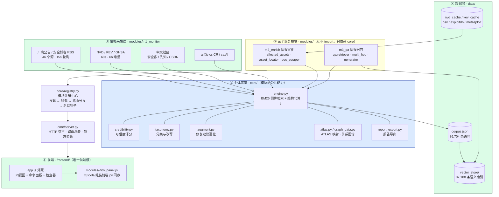
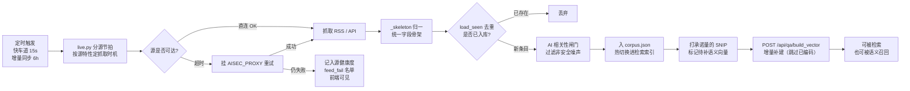
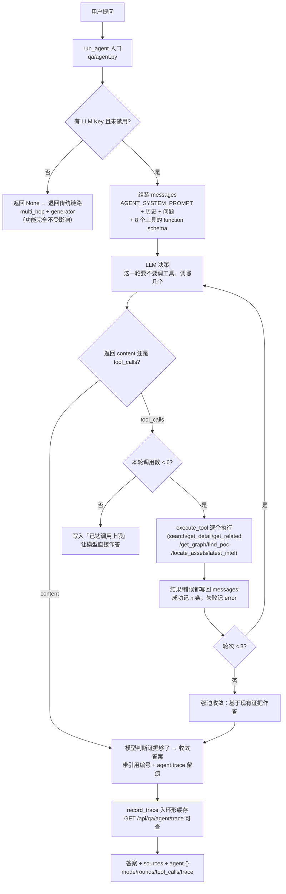
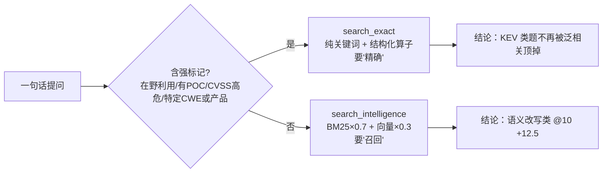
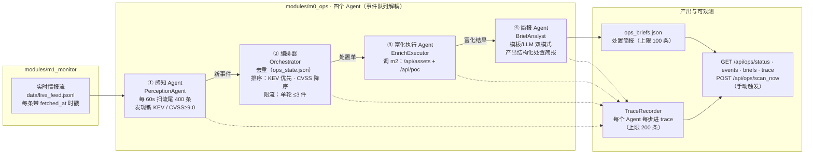

# 架构设计图与流程图 · AI-SecIntel（aisec-D 2.2）

> 这份文档回答一个问题：**这个系统是怎么搭起来的、数据怎么流动、智能体在哪決策**。
> 之前只有目录树和文字描述，评委翻不到"图"；这里把五张关键图补齐（v2.2 新增图五：多智能体事件驱动链路）。
> 所有节点都能在代码里点到，图旁边标了文件名，便于答辩时被追问时现场翻。

---

## 图一：系统总体架构（分层 + 依赖方向）



**这张图要讲的三句话**

1. **依赖是单向的**：`modules/* → core`，主体从不 import 模块，模块通过注册中心反向挂进来 —— 这是"合并即拷贝目录"能成立的根本原因。
2. **三层分明**：采集层只管拿数据入库，主体底座只管检索与评分，模块只管各自业务。任何一层挂了，其余照跑（模块加载失败时 `registry.load_all()` 会打印异常后跳过，主体继续运行）。
3. **前端只有一个根**：服务只服务 `frontend/`，模块面板是同步进去的产物，不是手写进去的。

---

## 图二：情报采集与入库流水线（自动化全链路）



**对应的自动化率**：`评测/结果/量化评测.md` A1.2 —— 采集通道 8 条自动 7 条（87.5%），必需人工步骤 0，**无人干预率 100%**。
唯一"手动"的条目是 `POST /api/refresh`，属于按需补一轮，不计入必需步骤。

---

## 图三：智能体工具调用链路（优化指标 C1 的主体 · v2.1 强化）

这是 15 分"智能体架构设计"的核心答卷。**v2.1 的关键变化：工具怎么调，由模型自己决定**。



**三条安防设计**（都是被真实问题逼出来的）

| 风险 | 怎么挡 | 证在哪 |
|---|---|---|
| 模型陷入"检索—不满意—再检索"死循环 | 单题工具 ≤6 次、轮次 ≤3，超了就强迫收敛并如实标记 `round-limit` | `agent.py: MAX_CALLS/MAX_ROUNDS` + 自测第 5 组 |
| 某个工具挂了拖垮整链路 | 工具异常不外抛，转成 `{"error":...}` 喂回给模型，让它自己换路 | `execute_tool()` + 自测第 4 组 |
| 没配 Key / 模型不可用就变废物 | 一律返回 `None`，上层自动退回 multi_hop 传统路径，**63 项原有自测行为不变** | `qa/__init__.chat()` + 自测第 2 组 |

**工具清单（8 个，全部落地到本机能力，没有一个外部 API）**

| 工具 | 干什么 | 落到哪 |
|---|---|---|
| `search_intelligence` | 语义+关键词混合检索（口语化提问） | 进程内 `retriever.hybrid_search` |
| `search_exact` | 精确路径检索（强标记过滤题） | 进程内 `retriever.hybrid_search(skip_vector=True)` |
| `get_detail` | 漏洞全量详情 | `retriever.get_detail` → `/api/detail` |
| `get_related` | 关联情报（跨文档推理） | `/api/related` |
| `get_graph` | 关系图谱 | `/api/graph` |
| `find_poc` | 公开 POC/EXP + A/B/C/D 分级 | `/api/poc`（模块2 能力） |
| `locate_assets` | 受影响资产 + 测绘语法（不扫主机） | `/api/assets`（模块2 能力） |
| `latest_intel` | 最近实时监测新情报 | `/api/live`（模块1 能力） |

> **可验证性**：以上不是写在文档里的形容词 —— `GET /api/qa/agent/tools` 会原样吐出工具注册表，
> `GET /api/qa/agent/trace` 给出最近几次问答真实调用过的工具序列；
> 离线自测 `py -3.13 tools/自测智能体.py`（不联网、零 token）可复跑 **26 项**验证。

### 图三附：为什么要有"精确/语义"两条检索路（一处真实踩坑）



**这是评测压出来的设计**：首版"一条路走天下"时，混合检索让「最近被在野利用的高危漏洞」这类题
的 @10 反而比纯关键词低 **16.7 个点**（语义的"泛相关"把真正的 KEV 条目顶下去了）。
现在 `strong_marker()` 识别出自然语言里的强标记信号后强制走精确路，两条各司其职、互不干扰。

可复跑验证：`tools/自测智能体.py` 第 6 组 —— 5 类强标记提问全部命中精确路，
3 类语义改写提问全部不误判（仍走混合检索，保住 @10 +12.5 的收益）。

**为什么这条链路算"智能体"而不是"搜索框"**：它有规划（Planner 拆子查询）、有工具调用（8 个已登记工具，HTTP 与进程内两类）、有条件分支决策（是否跳语义、是否硬过滤、是否强制多样性）、有降级容错（无 Key → 模板）。实测：12 道多跳题**引用准确率 95% · 深度达标率 100%**（`评测/结果/量化评测.md` B3）。

**诚实标注的弱项**：`在野利用` 类查询上混合检索 @10 比纯关键词低 16.7 个点（语义泛相关把 KEV 强标记题顶下去了），已定位，下一步是给这类查询强制走精确路 —— 评测脚本可复跑验证。

---

## 图四：模块注册与合并机制（"合并 = 拷贝目录"是怎么做到的）

```mermaid
sequenceDiagram
    participant S as core/server.py
    participant R as core/registry.py
    participant M as modules/&lt;id&gt;/api.py
    participant F as frontend/app.js

    S->>R: registry.load_all()
    loop 扫描 modules/*/module.json
        R->>R: discover() 读清单，config.json 判定 enabled
        R->>M: importlib 动态加载 entry(api.py)
        M->>R: register(ctx) 注册路由 + on_start 钩子
        R->>R: 写入路由总表 _get / _post
    end
    Note over R: 某个模块加载失败 → 打印异常后跳过，主体继续运行
    S->>R: registry.start()
    R->>M: 回调所有 on_start 钩子（起后台线程，如实况监测）
    S->>R: web_scripts()
    R-->>F: 模块 web/panel.js 列表注入 index.html
    Note over S,F: GET /api/modules 对外暴露「谁加载了、挂了哪些路由」
```

**这套机制的工程价值**（《结构说明与协作规范》第二节说过同一件事）：
三人并行开发不再需要合并 `server.py` / `app.js`，历史版本的"融合丢功能"事故由 `tools/verify_integrity.py` 兜底 ——
它拿基线的路由表、源码文件、函数清单、前端 JS 函数逐项比对，输出"失败 0 项"才允许合并。

---

## 图五：多智能体事件驱动链路（v2.2 新增 · 监测→富化→问答联动）

前面四张图里，三个业务模块各自独立工作；图五回答的是 v2.2 的核心问题 —— **"新威胁出现时，系统没人盯着也会自己动起来吗？"**
`m0_ops` 用四个职责单一的 Agent 组成事件驱动编排，把"发现新 KEV → 查明影响面 → 产出处置简报"这条过去要人手工点的链路变成全自动：



**为什么说这是"多智能体编排"而不是"一个定时脚本"**：
- **职责分离**：感知、决策、执行、产出四个角色各自独立，任一环节失败不影响其他环节，编排器只面对"事件"不面对"数据源细节"；
- **自主编排**：优先级（KEV 优先于纯高分）、限流（单轮 ≤3 件防惊群）、去重（状态文件跨重启续传）都是编排器自主决策，不是写死的线性流程；
- **跨模块联动**：富化执行 Agent 通过 HTTP 调 m2 的真实接口（`/api/assets`、`/api/poc`），复用已有能力而不是另写一套；
- **全程可审计**：`GET /api/ops/trace` 能看到"哪个 Agent、哪一刻、对哪个 CVE、做了什么、结果如何"。

**实弹演练（可复跑）**：向 `live_feed.jsonl` 注入一条 KEV 事件（演练 CVE），≤60s 内被感知 Agent 捕获，
编排器派单，富化执行 Agent 拉出真实受影响版本（如 gitlab 18.7.0–<18.11.12），简报 Agent 产出处置简报 ——
**从事件出现到简报落地约 61 秒**。步骤与结果见 `modules/m0_ops/docs/编排说明.md` 第四节；
离线单元测试 `py -3.13 modules/m0_ops/backend/test_orchestrator.py`（13 项，含跨实例简报幂等）。

**配套的可靠性兜底**：`tools/watchdog.py` 看门狗保证这条链路"一直在" —— 单实例锁防止重复起服务互踩数据，
崩溃按 5/15/60s 指数退避自动重启（1 小时窗口 ≤10 次），30s 探活连续 3 次失败判定挂起、杀进程重启。
守护模式启动：双击 `启动服务_守护.bat`。

---

## 附：一张表看完"图对应哪份代码"

| 图 | 核心代码 | 验证方式 |
|---|---|---|
| 图一 总体架构 | `core/registry.py` `core/paths.py` `config.json` | `GET /api/modules`；`python tools/verify_integrity.py` |
| 图二 采集流水线 | `modules/m1_monitor/backend/live.py` `monitor.py` | `GET /api/sources` `GET /api/live`（看 feed_ok/feed_fail） |
| 图三 Agentic RAG | `modules/m3_qa/backend/qa/multi_hop.py` `retriever.py` `generator.py` | `python tools/评测检索.py --compare` |
| 图四 注册机制 | `core/registry.py` `tools/组装前端.py` | `python tools/组装前端.py --check` |
| 图五 多智能体编排 | `modules/m0_ops/backend/orchestrator.py` `api.py`；`tools/watchdog.py` | `GET /api/ops/trace`；`py -3.13 modules/m0_ops/backend/test_orchestrator.py`；`py -3.13 tools/自测守护.py` |

> **一个值得讲的设计教训**：图三中"是否结构化查询"这一决策点在 `retriever.py` 里实现，
> 而"两路分数各自归一化再加权"是踩过坑之后才定下来的 —— 首版按常见做法做 50/50 排名融合，
> 实测**不升反降**（@10 90.0% → 87.5%，P50 +100ms）。定位到两个真问题后才改：
> ① 两路分数量纲不同，必须各自归一化再加权；② 纯字段过滤查询里所有候选同分，
> 归一后被整体压成 0 分、反被语义路顶掉（`cwe:`/`kev:` 题一度从 100% 掉到 0%）。
> 这条经验已写进 `测试报告/检索评测.md` 第五节 —— 答辩时它是"我们有量化闭环"的最好证据。
